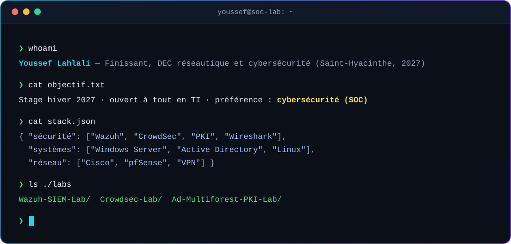
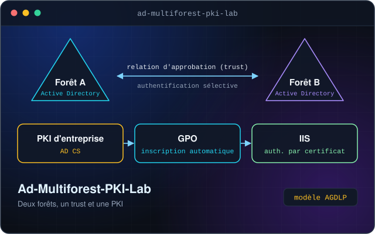
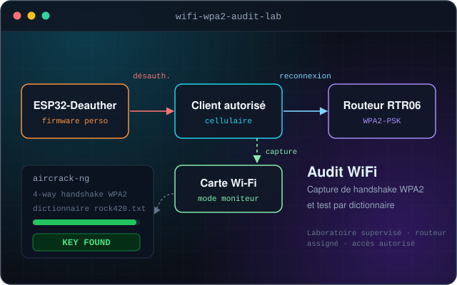

[Français](./README.md) · **English**

## 🎯 About me

What I care about is **defensive security**: watching an environment, spotting what is abnormal in the logs, understanding the attack and responding to it.

How I work:

- I **build my own labs** to practice what I learn
- I **document everything**: commands, screenshots, problems and how I solved them
- I don't let go of a technical problem until I've found the root cause

🔎 **I'm looking for an internship for winter 2027.** I'm open to any area of IT, with a preference for **cybersecurity (SOC)**.

---

## 🛠️ Stack

<table>
  <tr>
    <td align="center"><b>Defensive security</b></td>
    <td>
      
      
      
      
      
      
    </td>
  </tr>
  <tr>
    <td align="center"><b>Network</b></td>
    <td>
      
      
      
      
    </td>
  </tr>
  <tr>
    <td align="center"><b>Systems</b></td>
    <td>
      
      
      
      
      
      
    </td>
  </tr>
  <tr>
    <td align="center"><b>Virtualization</b></td>
    <td>
      
      
      
      
    </td>
  </tr>
  <tr>
    <td align="center"><b>Scripting &amp; tools</b></td>
    <td>
      
    </td>
  </tr>
</table>

---

## 🚀 Featured projects

<table>
  <tr>
    <td width="50%" valign="top">
      
      <h3><a href="https://github.com/Xsefzer/Wazuh-SIEM-Lab">Wazuh-SIEM-Lab</a></h3>
      
Home SOC lab: a <b>Wazuh</b> server collects logs from a Windows host and raises alerts. <b>Detection and monitoring</b>, with a script and full documentation.

      
      
      
    </td>
    <td width="50%" valign="top">
      
      <h3><a href="https://github.com/Xsefzer/Crowdsec-Lab">Crowdsec-Lab</a></h3>
      
CrowdSec on Windows: analysis of <b>authentication events</b>, alert review, and a <b>firewall bouncer</b> that blocks the attacker's IP address.

      
      
      
    </td>
  </tr>
  <tr>
    <td width="50%" valign="top">
      
      <h3><a href="https://github.com/Xsefzer/Ad-Multiforest-PKI-Lab">Ad-Multiforest-PKI-Lab</a></h3>
      
Two AD forests linked by a <b>selective-authentication trust</b>, <b>AGDLP</b> model, enterprise PKI with certificates deployed through GPO and certificate-based authentication on IIS.

      
      
      
    </td>
    <td width="50%" valign="top">
      
      <h3><a href="https://github.com/Xsefzer/Wifi-WPA2-Audit-Lab">Wifi-WPA2-Audit-Lab</a></h3>
      
Audit of a <b>WPA2-PSK</b> network in a supervised lab: capture of the <b>4-way handshake</b> with a card in monitor mode, then an offline dictionary test. Hardware side built around an <b>ESP32</b>.

      
      
      
    </td>
  </tr>
</table>

---

## 📚 Other coursework projects

- **SSTP VPN with certificates:** RRAS server, diagnosis of a connection failure by checking three causes (certificate expiration, trust in the certificate authority, certificate name), and a script to automatically back up the configuration.
- **Active Directory password filter:** blocking weak or already-compromised passwords in a domain.
- **Full ESXi server:** ESXi deployed on a physical server, pfSense firewall, Ubuntu with Docker and Portainer, port forwarding.
- **Cisco enterprise network:** VLANs, routing and access control lists (ACLs) on a multi-site network.
- **Self-hosting:** Ubuntu server running Docker services, reachable remotely through Tailscale without opening any port to the Internet.

---

## 🎓 Education &amp; certifications

**DEC – Computer Science, Networking and Cybersecurity (420.B0)**
*Cégep de Saint-Hyacinthe* · expected 2027

| **Certification** | **Provider** | **Status** |
| --- | --- | --- |
| **CompTIA Security+ (SY0-701)** | CompTIA | 🔄 In progress |
| **Cisco – Networking (CCNA 1 to 3)** | Cisco Networking Academy | ✅ Completed in the program |

---

## 🤝 Let's talk

Looking for an IT intern? I'm open to any area, and cybersecurity (SOC) is the one that draws me most. Reach out, I reply quickly.

📧 **yssflhl@gmail.com** · 📍 Montreal, Quebec

---

### *"I don't let go of a problem until I've found the root cause."*

