---

## 🎯 À propos de moi

Je m'appelle **Youssef Lahlali**, finissant au **DEC en Techniques de l'informatique, réseautique et cybersécurité** au Cégep de Saint-Hyacinthe, établi à Montréal.

Ce qui m'intéresse, c'est la **sécurité défensive** : surveiller un environnement, repérer ce qui est anormal dans les journaux, comprendre l'attaque et y répondre.

Ma façon de travailler :

- Je **monte mes propres laboratoires** pour pratiquer ce que j'apprends
- Je **documente tout** : commandes, captures, problèmes rencontrés et solutions
- Je ne lâche pas un problème technique tant que je n'ai pas trouvé la cause

🔎 **Je cherche un stage pour l'hiver 2027.** Je suis ouvert à tous les domaines des TI, avec une préférence pour la **cybersécurité (SOC)**.

---

## 🛠️ Stack

<table>
  <tr>
    <td align="center"><b>Sécurité défensive</b></td>
    <td>
      
      
      
      
      
    </td>
  </tr>
  <tr>
    <td align="center"><b>Réseau</b></td>
    <td>
      
      
      
      
    </td>
  </tr>
  <tr>
    <td align="center"><b>Systèmes</b></td>
    <td>
      
      
      
      
    </td>
  </tr>
  <tr>
    <td align="center"><b>Virtualisation</b></td>
    <td>
      
      
      
      
    </td>
  </tr>
  <tr>
    <td align="center"><b>Scripts et outils</b></td>
    <td>
      
    </td>
  </tr>
</table>

---

## 🚀 Projets en vedette

### 🔎 [Wazuh-SIEM-Lab](https://github.com/Xsefzer/Wazuh-SIEM-Lab)

Laboratoire SOC maison avec le SIEM Wazuh : détection et surveillance.

- Serveur **Wazuh** sur Ubuntu Server dans VMware, avec un agent sur un poste Windows
- Centralisation et analyse des journaux de sécurité dans le tableau de bord
- Script de surveillance et documentation du lab

**Technologies :** Wazuh, Ubuntu Server, Windows, VMware, PowerShell

### 🚨 [Crowdsec-Lab](https://github.com/Xsefzer/Crowdsec-Lab)

Laboratoire CrowdSec sur Windows : détecter une attaque et la bloquer automatiquement.

- Bouncer pare-feu qui bloque les adresses IP malveillantes
- Analyse des événements d'authentification Windows
- Observation des alertes générées par CrowdSec

**Technologies :** CrowdSec, Windows, pare-feu Windows

### 🔐 [Ad-Multiforest-PKI-Lab](https://github.com/Xsefzer/Ad-Multiforest-PKI-Lab)

Deux forêts Active Directory reliées par une relation d'approbation, avec une PKI d'entreprise.

- Trust entre deux forêts avec **authentification sélective**
- Gestion des accès selon le modèle **AGDLP**
- PKI d'entreprise avec **inscription automatique des certificats par GPO**
- Authentification par certificat sur IIS

**Technologies :** Windows Server, Active Directory, AD CS, GPO, IIS

---

## 📚 Autres projets de formation

- **VPN SSTP avec certificats :** serveur RRAS, diagnostic d'une panne de connexion en vérifiant trois causes (expiration, confiance envers l'autorité de certification, nom du certificat), et script de sauvegarde automatique de la configuration.
- **Filtre de mots de passe Active Directory :** blocage des mots de passe faibles ou déjà compromis dans un domaine.
- **Serveur ESXi complet :** déploiement d'ESXi sur un serveur physique, pare-feu pfSense, Ubuntu avec Docker et Portainer, redirection de ports.
- **Réseau d'entreprise Cisco :** VLAN, routage et listes de contrôle d'accès (ACL) sur un réseau multi-sites.
- **Auto-hébergement :** serveur Ubuntu avec services Docker, accessible à distance par Tailscale sans ouvrir de port sur Internet.

---

## 🎓 Formation et certifications

**DEC – Techniques de l'informatique, réseautique et cybersécurité (420.B0)**
*Cégep de Saint-Hyacinthe* · fin prévue en 2027

| **Certification** | **Organisme** | **Statut** |
| --- | --- | --- |
| **CompTIA Security+ (SY0-701)** | CompTIA | 🔄 En préparation |
| **Cisco – Réseautique (CCNA 1 à 3)** | Cisco Networking Academy | ✅ Cours complétés au DEC |

---

## 🤝 On se parle ?

Vous cherchez un stagiaire en TI ? Je suis ouvert à tous les domaines, et la cybersécurité (SOC) est celui qui m'attire le plus. Écrivez-moi, je réponds rapidement.

📧 **yssflhl@gmail.com** · 📍 Montréal, Québec

---

### 💬 *« Je ne lâche pas un problème tant que je n'ai pas trouvé la cause. »*

